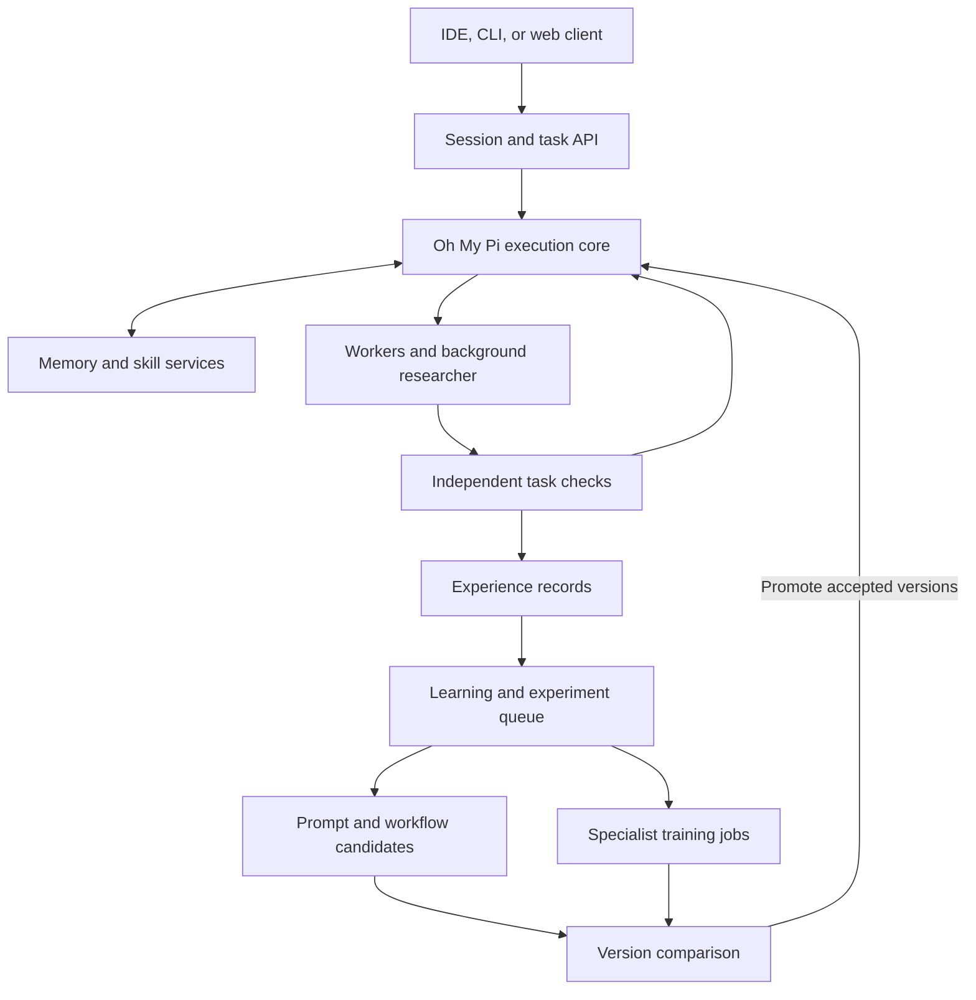

# Final Agent Platform Blueprint

Prepared for Malay Patel. Planning date: October 30, 2026.
Purpose: the final product concept, architecture, component map, learning design, and implementation brief for development with Devin.

Scope decision: all additions recommended in this planning conversation are included below with an assigned responsibility and delivery phase. Advanced capabilities ship in later milestones; they remain part of the target product. mini-swe-agent is included as an independent baseline. External memory providers remain supported through an adapter interface rather than competing default stores.

This is a proposed architecture. Upstream capabilities cited in the source register are building blocks; their interoperability, performance, and deployment readiness must be established during implementation.

## 1. The product

Build an IDE-connected agent platform that completes projects, remembers useful context, researches in the background, and develops better workflows and specialist model adapters from verified experience.

The user gives an outcome, such as “Build and test this application” or “Prepare a sourced company research report.” The platform organizes the work, uses tools, gathers evidence, checks results, and delivers artifacts. It then identifies reusable lessons and tests proposed improvements for future tasks.

The product has three learning mechanisms:

- Context learning: update durable facts, preferences, retrieved knowledge, and procedural skills.
- Harness improvement: experiment with prompts, tool implementations, context selection, and agent workflows.
- Model improvement: periodically train and evaluate specialist adapters on reviewed examples.

Each mechanism is versioned and evaluated according to what it changes. A saved fact is not a trained model, and a more elaborate workflow is not automatically an improvement.

The long-term goal is a platform that supports many specialties. Each specialty requires its own data, tools, and evaluation. No finite implementation can promise reliable expertise at absolutely every task.

## 2. Who it serves and where it starts

Start as a personal tool for a builder working with Devin. Make coding and sourced technical research the first two task families. They support useful tool integrations and comparatively concrete checks.

The initial user should be able to:

1. Open a repository in VS Code.
2. Describe a desired change.
3. Watch the main agent work and inspect research findings arriving in parallel.
4. Review diffs, execution results, and the final deliverable.
5. Start a new session and have important project context recalled.
6. See proposed learning updates and the evidence behind accepted changes.
7. Compare the current agent against a candidate version.
8. Later, request a specialist training experiment and inspect its results.

Expand into business analysis, documents, spreadsheets, marketing, or other domains through task packs: instructions, tools, data sources, reference examples, and independent evaluations.

## 3. The system ownership decisions

Use one authoritative agent runtime and one owner for each persistent store. Integrate selected components from other projects through adapters.

| Responsibility | Owner in this architecture | Starting point |
| --- | --- | --- |
| Live agent execution, tool dispatch, sessions, streaming, compaction | Execution core | Oh My Pi SDK or a maintained fork |
| Core profile facts and project memory | Memory service | Hermes memory behavior and reusable implementation where feasible |
| Search of completed conversations | History index | Index the execution core’s original session events using Hermes-style recall |
| Learned procedural skills and versions | Skill service | OpenClaw Workshop lifecycle, informed by Hermes curation |
| Learning review scheduling | Background scheduler | One review pipeline using selected OpenClaw/Hermes patterns |
| Isolated experiments and task evaluation | Evaluation service | Harbor adapter and domain-specific verifiers |
| Prompt experiments | Optimization worker | GEPA |
| SFT and adapter training | Training worker | Hugging Face TRL and PEFT |
| Specialist adapter serving | Inference service | vLLM when self-hosted serving is needed |

Oh My Pi is primarily TypeScript with native components; Hermes includes Python. Devin must inspect dependency boundaries before deciding to wrap a component, adapt its behavior, or port a small implementation with tests. Importing several complete agent loops would create competing session, prompt, tool, and memory ownership.

The canonical conversation is the execution core’s event journal. A SQLite search index is derived from it. Core memory files are authoritative for curated facts, and skill files plus saved versions are authoritative for procedures. Derived indexes must be rebuildable.

## 4. What to reuse, and when

| Source | Selected component | Implementation approach | Stage |
| --- | --- | --- | --- |
| Oh My Pi | SDK, sessions, model integration, editing, LSP/DAP, subagents, async work, compaction | Keep the core intact where possible; use extensions or documented SDK interfaces | Foundation |
| Hermes | Bounded profile memory, memory operations, session recall, lesson extraction | Wrap or adapt selected modules after auditing dependencies; preserve behavioral tests | Foundation |
| OpenClaw | Versioned learned skills, drafts, undo, maintenance, idle review scheduling, retrieval/consolidation, gateway patterns | One adapted skill/review service, one memory owner, and channel adapters into the common API | Foundation through product hardening |
| Harbor | Task environments, verifiers, agent adapters, trajectories | Add a custom runner for the execution core and task packs for chosen domains | First learning release |
| DSPy / GEPA | Feedback-driven prompt optimization | Optimize explicit prompt targets through a common scoring interface | First learning release |
| TRL / PEFT | SFT, LoRA, and QLoRA support | Separate Python training jobs with versioned input manifests | Specialist pilot |
| Aider | Ranked repository maps | Implement a cached context-selection component; benchmark its effect | Coding context milestone |
| Browser Use | Browser interaction | Implement browser work through a bounded tool/service interface | Browser milestone |
| Cline | Editor experience, task UI, checkpoint patterns | Adapt selected UI components and patterns; connect to the chosen execution core | IDE milestone |
| OpenHands SDK | Remote workspaces and Agent Server interfaces | Implement a remote execution provider alongside the core’s local isolation | Remote execution milestone |
| vLLM | Serving compatible LoRA adapters per request | Register accepted adapters on their compatible base model | Specialist serving |
| Agent Lightning | Request capture, rollouts, reward-based model training | Implement a reward-based training backend after SFT and repeatable task rewards work | RL milestone |
| Darwin Gödel Machine | Agent-version archive and branching experiments | Implement the exploration method in an offline experiment manager | Harness evolution milestone |
| mini-swe-agent | A small independent coding agent and trajectory format | Run a pinned baseline under matched evaluation conditions | Evaluation milestone |

Retain attribution and license notices and check separately licensed components, model weights, datasets, and hosted-service terms. Pin exact revisions in a source manifest. A capability shown in a repository does not establish that it is a standalone module.

## 5. Runtime architecture

The client displays progress and sends user instructions. A local service can own sessions and background jobs so closing an IDE panel does not necessarily end work. Background work only continues while an authorized execution host remains running.

Training and expensive experiments run in separate processes or remote workers. They obey configured resource and spending limits and do not block the interactive session.

## 6. Memory design

Use the Hermes division between small core memory, searchable history, and on-demand procedures. Add explicit provenance and concurrency controls for a multi-agent product.

| Layer | Contents | Loading rule |
| --- | --- | --- |
| User profile | Stable preferences, communication style, standing expectations | Compact session-start snapshot |
| Agent/project memory | Durable environment facts and conventions | Compact snapshot scoped to the project |
| Episodic history | Conversations, tool actions, observations, decisions | Search and read surrounding events when needed |
| Procedural skills | Repeatable workflows, commands, prerequisites, pitfalls | Discover by description; load the relevant skill |
| Knowledge sources | Documents, research evidence, code maps, indexed material | Retrieve relevant passages with their source/version |
| Working task state | Plan, progress, pending research, checkpoints | Persist for the current task; expire or archive at task completion |
| Experience and evaluation | Outcomes, corrections, metrics, verified examples | Used by review, evaluation, and training pipelines |

Hermes documents default core-memory budgets of 2,200 characters for MEMORY.md and 1,375 for USER.md. Treat these as configurable starting budgets. The session-start snapshot remains stable to support prompt caching; live tool results and conversation context can carry updates before the next session.

The memory service should:

- Support add, patch, and remove, including atomic batches against the final size budget.
- Reject overflow with an actionable result instead of silently discarding facts.
- Preserve revision history and reject stale writes using expected versions.
- Record where a fact came from, when it was observed, and what it supersedes.
- Keep original evidence separate from generated summaries or inferences.
- Apply owner, project, workspace, and sharing scope before retrieval.
- Let the user inspect, correct, export, and delete memories.
- Exclude deleted evidence from future indexing and dataset creation, while clearly reporting any previously trained model that used it.

Research workers submit candidate findings. A memory write service serializes accepted updates. Do not let several workers independently rewrite the same profile file.

Use keyword search for exact symbols and identifiers and semantic retrieval for differently worded related ideas. Index results include source references and timestamps. Retrieval must return “no relevant result” when appropriate.

A saved lesson such as “this method worked once” should retain that scope. It must not become an unconditional global rule without supporting evidence.

## 7. Agent roles and scheduling

| Role | Main job | Expected authority |
| --- | --- | --- |
| Coordinator | Interpret the request, plan work, choose tools and specialists | Creates bounded tasks and manages task state |
| Worker | Produce the requested code or artifact | Uses task-specific tools and its assigned workspace |
| Researcher | Resolve a concrete uncertainty and return sourced findings | Read/search tools by default |
| Reviewer | Inspect the result, evidence, and failure modes | Read artifacts and request independent checks |
| Learning curator | Propose durable facts and procedural changes | Submit memory/skill proposals through controlled services |
| Experiment worker | Test prompt, tool, or workflow candidates | Modify an isolated candidate version |
| Training worker | Build datasets and train/evaluate adapters | Operate on approved dataset snapshots and configured compute |

These are roles, not seven mandatory concurrent agents. A simple task may use one worker and deterministic checks. Complex tasks can add researchers or specialist workers.

A researcher request should specify the question, known context, source requirements, deadline, and output schema. Its result should distinguish evidence, recommendation, confidence, and remaining uncertainty.

Use scheduling priorities: foreground work, relevant research, task review, learning maintenance, offline experiments, then training. Bound concurrency, recursion depth, tokens, elapsed time, and compute spending.

Persist jobs with ids, input versions, state, leases, cancellation flags, and output artifact references. Handle worker crashes and retries without duplicating completed work. Reconcile external side effects before retrying them; a queue alone does not guarantee exactly-once execution.

Cancel or mark findings stale when the task changes. Prevent a background reviewer’s output from recursively scheduling reviews of itself.

## 8. The task improvement loop

1. Turn the user’s request into an explicit outcome and checkable acceptance criteria.
2. Retrieve necessary project context and relevant skills.
3. Choose the smallest sufficient worker/tool arrangement.
4. Launch background research for important unknowns.
5. Produce an initial result in a controlled workspace.
6. Run independent checks and collect actual execution evidence.
7. Revise specific failures within the configured budget.
8. Deliver the artifact, verification summary, and material unresolved issues.
9. Save a structured experience record.
10. Queue candidate lessons when the work produced reusable evidence.

For coding, checks can include unit/integration tests, language-server diagnostics, application execution, and browser checks. For research, use source verification, calculation checks, required coverage, and grounded assessment by a suitable reviewer.

An LLM’s statement that a test passed is not test evidence. Store the command, environment, exit status, output reference, and evaluator version.

## 9. The persistent RSI loop

Treat RSI as controlled experiments on the agent system.

### Proposal

A proposal names a specific observed problem, cites supporting runs, identifies the component to change, states a hypothesis, and defines the measurements and resource budget.

Example: “The worker selected the wrong files in six similar bug-fix tasks. A ranked repository map may improve file selection while keeping total cost acceptable.”

### Experiment

1. Freeze the baseline model, prompts, skills, retrieval settings, tools, and environment.
2. Create a candidate in a separate branch or workspace.
3. Run the same optimization tasks under comparable budgets.
4. Track quality, failures, cost, and time.
5. Keep an independent final test set outside optimization and candidate selection.
6. Repeat noisy comparisons when needed and record uncertainty.
7. Run regression tasks from other supported task families.

Candidate agents must not modify the acceptance evaluator, hidden answers, permission controls, or experiment accounting. Enforce those boundaries outside the candidate’s own prompts.

### Selection and deployment

Keep a production baseline and an archive of research candidates. A candidate can be retained as an interesting research branch without being deployed.

A production promotion requires a documented improvement, acceptable regressions and cost, reproducible version references, and rollback support. Early versions should make promotion reviewable; later policies may automate low-impact changes when their criteria are satisfied.

Track candidate states: proposed, running, evaluated, accepted, rejected, deployed, rolled_back, and archived. A deployed change must be tied to the exact results that justified it.

Use GEPA for explicit prompt targets. Use Oh My Pi’s experiment loop for measured code/workflow changes. Consider DGM-style branching after the basic evaluation system works.

## 10. Specialist development and fine-tuning

An expert version is a task package containing:

- A domain definition and supported task types.
- Appropriate tools and current reference material.
- Instructions and procedural skills.
- A base-model revision and optional trained adapter.
- A versioned evaluation suite and known limitations.
- Routing and fallback rules.
- A record of which settings and datasets produced it.

Expertise is demonstrated on defined tasks. Fine-tuning is one way to improve the package; retrieval and tool access remain important.

### Supervised training pipeline

1. Identify a repeated task that the base system handles inconsistently or expensively.
2. Collect inputs, relevant available context, tool interactions, verified outputs, corrections, and independent outcomes.
3. Review examples for correctness, relevance, privacy, and permitted training use.
4. Remove duplicates and near-duplicates; split related sessions/projects together to avoid leakage.
5. Separate training, validation, and final evaluation data.
6. Train a small pilot adapter using a supported open-weight model.
7. Evaluate the resulting model inside the actual agent harness.
8. Compare it with the base model, a prompt-optimized baseline, and the current specialist.
9. Deploy only if the chosen acceptance criteria pass.

Use observable messages, actions, observations, and reviewed results. The pipeline does not require access to a model provider’s private reasoning.

SFT teaches desired outputs from examples. LoRA trains small low-rank adapter parameters while freezing the base weights. QLoRA typically stores the frozen base in 4-bit form while training adapters at suitable precision. Total training memory also depends on sequence lengths, activations, optimizer state, and configuration.

Use TRL’s supervised trainer and PEFT support after confirming compatibility with the selected model and hardware. There is no universal example count, GPU size, or training duration that guarantees a good specialist.

### Training manifest

Record dataset hashes and versions; filtering rules; train/validation/test assignment; model and tokenizer revisions; chat template; tool schemas; precision; quantization; adapter configuration; software versions; seeds; hardware; and evaluation results.

For tool-using examples, retain enough context to interpret each action and result correctly. Configure the loss mask intentionally so irrelevant observations are not accidentally treated as desired assistant output.

### Serving and further learning

Serve compatible accepted adapters through a suitable inference service such as vLLM. An adapter must be associated with its exact compatible base model and serving configuration.

Package accepted specialists in a Hugging Face-compatible format: adapter weights/configuration, exact base-model reference, relevant tokenizer/chat-template references, model card, evaluation report, and dataset lineage. Support Hub export with an explicit destination and visibility setting; keep source-data permissions separate from the code license.

Keep running sessions on a coherent version. Introduce a newly accepted adapter at controlled task/session boundaries.

Investigate reinforcement learning through Agent Lightning only after the task has a reliable reward and the SFT/evaluation pipeline is functioning. RL is a separate optimization stage with its own compute and evaluation requirements.

## 11. Integration decisions for every added component

These are target architecture decisions. The source audit establishes exact revisions and extraction details; it does not reopen who owns each subsystem.

### Oh My Pi: execution and experiment primitives

Embed the SDK behind the platform API. Keep its model integrations, file tools, session journal, language-server/debugger tools, and subagent machinery. Normalize its emitted events into the platform event format.

Expose its experiment primitives through the experiment service. Budget and scope enforcement live outside the experiment agent. Use a maintained fork only for changes that cannot be delivered through the SDK or extension surface.

### Hermes: memory semantics

Implement a Hermes-compatible memory service with profile/project separation, bounded snapshots, atomic operations, and searchable history. Reuse the relevant Python implementation where the dependency boundary is practical. Otherwise port the narrow behavior with characterization tests against the pinned source.

Index the platform’s canonical session journal for recall; do not start a second live Hermes agent loop. Preserve access to original messages around a search hit.

### OpenClaw: skill lifecycle and background scheduling

Implement skill revisions, proposals, undo, archival, maintenance, and a learning-review scheduler. Combine this with Hermes-style usage signals and curation.

The reviewer proposes procedures. The skill service performs versioned writes. The runtime loads explicit skill revisions from its version manifest. Candidate skill changes remain separate from accepted procedures until their applicable checks pass.

Adapt OpenClaw’s hybrid retrieval and background consolidation into the memory service: daily observations can become proposed durable facts when supported by evidence. Relevance, recency, importance, and result diversity are explicit retrieval settings. Core memory budgets and revision controls still apply.

Add messaging gateway/channel adapters in the full product so chat clients can start, inspect, steer, and cancel the same tasks as the IDE. Reuse OpenClaw’s long-running gateway and connection patterns where practical. Keep task/session ownership in the platform API rather than creating an independent agent history for every channel. Carry identity, project scope, permissions, and delivery preferences across each adapter.

### Cline: IDE experience

Adapt the IDE-facing experience to show conversations, task progress, file changes, and checkpoints. Connect it to the platform API and event stream.

The platform execution core owns tool calls and agent state. The extension is a client. Surface exact workspace/checkpoint identity so restoration targets the intended task environment. Preserve pre-existing user changes.

### Aider: repository context

Implement a repository-map provider that extracts symbols and ranks relevant code structure within a token budget. Cache maps by repository and file revision, and invalidate affected parts on change.

Combine the map with language-server navigation and exact file reads. The map guides inspection; the agent still reads implementation details when needed. Compare enabled and disabled configurations on representative tasks.

### Browser Use: website interaction

Run browser work through a browser worker that returns actions, observations, screenshots or extracted content as appropriate, and artifacts.

Provide separate browser sessions for tasks unless sharing is intentional. Tool policy controls which actions the worker can execute. The coordinator can route a browser subtask to this worker without creating an unrelated conversation history.

### OpenHands SDK: remote execution

Implement a remote workspace provider that uses Agent Server/workspace interfaces for shell, files, and task artifacts. The platform remains responsible for planning and model calls.

Start with local isolated execution and add the remote provider behind the same interface. Establish the actual isolation boundary in the deployment environment: a remote server interface by itself is not a guarantee of OS isolation.

### Harbor: independent evaluation

Implement a custom platform-agent adapter, common task packaging, environment setup, verifier integration, artifact capture, and result import.

Use task-specific verifiers for coding and other supported domains. Keep the final evaluator and its private answers outside candidate write access. Harbor runs the comparison; the platform stores version links and promotion decisions.

### GEPA: prompt optimization

Expose a fixed set of prompt targets, such as research query planning, evidence synthesis, reviewer instructions, or tool-selection guidance.

Wrap each target in an executable program whose results can be scored. Supply task examples and meaningful textual feedback. Persist candidate prompts and all evaluation results. Keep a final test set separate from examples used for reflection and candidate selection.

### mini-swe-agent: independent baseline

Run a pinned small coding-agent baseline through the same benchmark environment. Match the model, available task evidence, resource budget, and tool capabilities as closely as the comparison requires; document any differences.

Its purpose is to reveal whether additional orchestration provides measurable value. Keep its runtime independent from the product’s live execution core.

### Darwin Gödel Machine: branching harness evolution

Implement an archive of candidate agent manifests and their lineage. Propose code/tool/workflow mutations from selected ancestors and evaluate each in isolation.

Maintain a production champion separately from the research archive. Research selection may preserve diverse stepping stones. Deployment selection still requires passing quality, regression, cost, and reproducibility criteria.

### TRL and PEFT: supervised specialization

Implement versioned dataset export, training job manifests, LoRA/QLoRA configuration, checkpoint capture, evaluation, and adapter packaging.

Begin with supervised training on reviewed examples. Adapter deployment is a distinct operation from finishing a training job.

### Agent Lightning: reward-based training

Implement a later training backend using the compatible release’s request-capture gateway, rollout controller, and trainer integration. Record which agent, tools, environment, and reward generated each rollout.

Begin with a narrow task family having an independently computable reward. Verify the chosen training/model/backend combination; do not assume every LoRA, quantization, and RL setting is interoperable.

### vLLM: specialist serving

Implement an inference-provider adapter that can select a compatible registered LoRA adapter for a request. Track base-model identity and adapter lineage.

Route through the platform’s model registry, preserve rollback, and verify the actual model’s tool-calling and tokenizer behavior. Keep training resources separate from interactive serving where resource contention affects latency.

### External memory provider interface

Support a configurable provider adapter for richer recall, such as Honcho or Hindsight. Keep built-in profile facts, history, and skills under their existing owners.

The provider must declare what it receives, retains, retrieves, and deletes. Only one provider is selected for any configured retrieval responsibility. Cloud and self-hosted options must not silently change the product’s data-sharing behavior.

## 12. Experience, datasets, and versioned records

Use a shared event envelope:

- schema_version, event_id, owner_id, project_id, session_id, task_id.
- Timestamp, event type, parent event/run id, and producing component.
- Execution/model/skill/tool versions where relevant.
- Payload reference, source references, and access scope.
- Cost and usage information when available.

Keep large raw outputs in an artifact store and reference them from events. A logical event may be indexed in several ways, but the canonical record has one identity.

| Record | Required information |
| --- | --- |
| Task | Request, scope, acceptance criteria, budget, status, selected specialist, artifact references |
| Tool execution | Requested action, environment, actual outcome, timestamps, output reference, error/retry linkage |
| Research finding | Question, sources, retrieval time, claim, supporting evidence, confidence, task applicability |
| Memory entry | Fact, target, scope, provenance, revision, observed/verified dates, supersession or deletion status |
| Skill revision | Instructions, prerequisites, source experience, parent revision, checks, status, usage signals |
| Evaluation | Task and evaluator revisions, exact agent manifest, measurements, failure categories, uncertainty |
| Improvement proposal | Evidence, hypothesis, component changed, baseline, budget, acceptance rules |
| Dataset example | Input/context, reviewed target/actions, outcome evidence, source runs, consent/use status, split |
| Training job | Immutable dataset/model/config references, progress, checkpoints, compute/cost, evaluation links |
| Specialist | Domain, task coverage, model/adapter, tools, skills, knowledge, evaluation, routing and fallback |
| Promotion | Candidate, baseline, evidence, decision policy, approver/policy identity, rollout and rollback state |

Store feedback separately from the original output. Preserve corrected examples as explicit revisions or pairs, so a rejected answer is not accidentally exported as a gold target.

The dataset builder must honor exclusions and deletions. Removing a source record from retrieval does not remove its influence from already trained weights. Track affected training manifests and support adapter retirement/retraining decisions.

## 13. Common service interfaces

These are proposed product contracts, not the native APIs of the upstream projects. Define typed schemas and adapters at each boundary.

| Interface | Required operations |
| --- | --- |
| Task/session API | Create, resume, inspect, steer, cancel, and stream events |
| Execution provider | Prepare workspace, read/write files, execute, checkpoint, collect artifacts, stop |
| Research service | Submit question, stream findings, cite sources, cancel, mark stale |
| Memory service | Read snapshot, add/patch/remove batch, search, inspect provenance, export/delete |
| Skill service | Discover, read exact version, propose, evaluate, accept, archive, restore |
| Evaluation service | Submit comparison, inspect progress, fetch results/artifacts, cancel |
| Optimization service | Register prompt target, propose candidates, evaluate, publish candidate artifact |
| Dataset service | Select examples, review, deduplicate, split, export, inspect lineage |
| Training service | Validate prerequisites, estimate/limit resources, submit, cancel, collect checkpoints |
| Model registry | Register, verify compatibility, evaluate, deploy, select, retire, roll back |

All background jobs reference immutable input versions. Use optimistic concurrency for mutable records and serialize writes where a shared file is authoritative.

A specialist registration should include at least domain/task coverage, model and tokenizer revisions, adapter identity, tools and skills, knowledge version, evaluation report, owner scope, and fallback. The router should explain why it selected a specialist and fall back when the task is outside tested coverage.

## 14. User experience

Provide three connected clients: VS Code for repository work, a CLI for automation and development, and a web dashboard for memory, experiments, and training. They share task identities and state.

| Surface | What the user sees |
| --- | --- |
| Task workspace | Goal, plan, progress, artifacts, interruptions, and completed checks |
| Research panel | Current questions, source-backed findings, and whether the worker used them |
| Changes panel | Diffs, execution results, checkpoints, and review comments |
| Memory explorer | Profile facts, project notes, provenance, corrections, and deletion controls |
| Skills | Accepted procedures, candidate changes, version history, usage, undo, and archival |
| Learning activity | What changed, why, supporting runs, and whether improvement was demonstrated |
| Experiments | Baseline versus candidate results, cost, runtime, regressions, and lineage |
| Model lab | Datasets, training jobs, checkpoints, evaluations, and supported specialties |
| Specialist registry | Coverage, model/adapter version, deployment state, fallback, and limitations |

Default to language such as “This procedure improved 8 of 20 evaluated tasks” only when those results exist. Do not present a memory save, skill creation, or completed training job as proof that the agent improved.

Give users autonomy controls: limits on background work, selected tools and sources, model/provider choices, automatic versus reviewed learning updates, training budgets, and promotion policies.

## 15. Engineering structure and deployment

Use TypeScript for the platform API, execution integration, scheduler, and clients. Use Python workers for adapted Hermes components, repository mapping where appropriate, GEPA, and model training. Define versioned transport schemas instead of sharing live in-process objects across languages.

Start with SQLite and local artifact directories for a single-user deployment. Add PostgreSQL/object storage and distributed workers when the deployment needs multiple hosts or users. The service interfaces should remain stable.

| Proposed repository area | Responsibility |
| --- | --- |
| apps/ide-extension | VS Code client and adapted editor UI |
| apps/cli | Local entrypoint, task controls, diagnostics |
| apps/dashboard | Memory, skill, experiment, and model views |
| packages/api | Authenticated local/remote task API and event stream |
| packages/contracts | Typed service/event schemas |
| packages/execution | Oh My Pi adapter and tool/session integration |
| packages/jobs | Durable queue, leases, budgets, cancellation, scheduling |
| packages/skills | Accepted/candidate skill revisions and maintenance |
| packages/experiments | Agent manifests, comparisons, archive, promotion policy |
| packages/providers | Model, browser, execution, and external-memory adapters |
| services/memory | Core memory, history indexing, retrieval, provenance |
| services/context | Repository mapping and knowledge retrieval |
| services/optimization | GEPA targets and scoring adapters |
| services/training | Dataset manifests, TRL/PEFT, Agent Lightning integration |
| evaluations | Harbor adapter, task packs, independent verifiers, baselines |
| documentation | Setup, source/license manifest, architecture, runbooks, evaluation reports |

Local development uses a small supervised service plus isolated execution. The remote execution provider adds OpenHands-based workspaces. Browser workers and training workers are separate processes. Each provider exposes health and compatibility checks.

Model calls can use hosted providers or suitable local models. Specialist training requires a model whose weights and terms permit the intended training/use. A paid inference API alone does not provide access to its model weights.

## 16. Delivery milestones and acceptance criteria

The full target product includes every component listed above. Ship in stages so failures have a clear cause and each stage leaves a usable system.

| Milestone | Components delivered | Acceptance evidence |
| --- | --- | --- |
| 0. Source and integration baseline | Pinned source manifest, licenses, environment checks, contract definitions | Every selected upstream component has a revision and integration owner; base runtime runs |
| 1. Usable coding workbench | Oh My Pi core, initial Cline-derived IDE experience, task/checkpoint state | Real repository change works through the editor; cancellation/resume and restoring a task checkpoint are demonstrated |
| 2. Memory and research | Hermes memory/recall, Aider context, researcher, Browser Use worker | New-session recall succeeds; corrections persist; scoped retrieval works; researcher delivers cited findings during work; browser task completes |
| 3. Persistent skill learning | OpenClaw lifecycle/scheduler, Hermes curation signals, dashboard | A supported lesson becomes a versioned procedure; update, rejection, undo, and archival work; background review does not recursively schedule itself |
| 4. Measured improvement | Harbor adapter, mini-swe baseline, independent verifiers, GEPA | Reproducible baseline/candidate comparison; prompt optimization uses a separate final test set; costs and regressions are recorded |
| 5. Remote execution and harness evolution | OpenHands workspace provider, Oh My Pi experiments, DGM-style archive | A task runs remotely through the same contract; an isolated harness candidate is compared; lineage and rollback are recoverable |
| 6. SFT specialist pilot | Dataset builder, TRL/PEFT, LoRA/QLoRA jobs, registry | A genuine small training run saves a usable adapter; leakage checks run; held-out agent-level evaluation compares it with the base |
| 7. Specialist serving and routing | vLLM provider, adapter compatibility checks, routing/fallback | Compatible accepted adapters serve requests; wrong-base adapters are rejected; task routing and rollback are demonstrated |
| 8. Reward-based training | Agent Lightning backend and reward/task integration | A bounded real rollout/training experiment produces auditable data and held-out results; training gains are distinguished from harness changes |
| 9. Product hardening and channels | Messaging gateway adapters, multi-user isolation where applicable, upgrades, recovery, monitoring, packaging | Chat clients control the same scoped tasks as the IDE; clean installation, recovery drills, migration/rollback, budget accounting, and end-to-end workflows pass |

A meaningful pilot may show no improvement. That is a valid experimental result; the product must report it honestly rather than promote the candidate.

Timeline depends on development skill, available time, credentials, hardware, and the compatibility audit. This milestone plan is the commitment structure; earlier rough estimates are not delivery guarantees.

## 17. How to judge the finished system

Track supported task success, severe regressions, source accuracy where relevant, memory retrieval accuracy, repeated-error rate, user corrections, cost per successful task, latency, and learning overhead.

Also track:

- Whether accepted changes remain useful on later tasks.
- How often a saved skill is loaded and helps, using evidence beyond load count.
- How often improvements are rolled back.
- Whether specialist adapters outperform a prompt-optimized base under equal conditions.
- Whether simpler baselines solve the same tasks more efficiently.
- Whether failed jobs resume or terminate cleanly with complete accounting.

An agent’s own confidence is one signal, not the outcome metric.

The first product proof should be: “Across a fixed, unseen set of coding tasks, this accepted change improved results or efficiency without unacceptable regressions.” Further domain claims require their own evaluation.

## 18. End-to-end example

The user asks: “Build a dashboard that analyzes companies and creates sourced research reports.”

1. The coordinator opens the project, recalls standing preferences, and loads the relevant development/research skills.
2. Aider-style context selection and LSP tools identify relevant code.
3. The worker implements the dashboard while a researcher checks data-source documentation and report requirements.
4. A Browser Use worker checks the running interface when browser interaction is required.
5. Independent tests and a reviewer identify calculation, citation, or UI failures; the worker addresses them.
6. The result includes working artifacts and actual verification evidence.
7. The curator proposes a reusable report-validation procedure, with references to this task’s successes and corrections.
8. The skill service stores the proposal and evaluates it before adding it to accepted procedures.
9. GEPA later tests revised research instructions on separate examples.
10. A DGM-style experiment may investigate a different tool sequence or retrieval strategy.
11. Once enough reviewed examples exist, an SFT experiment trains a report-writing or tool-use adapter.
12. Harbor and domain-specific verifiers compare the candidate with the current system.
13. If accepted, the registry makes the specialist available through compatible serving, with fallback and rollback.
14. A later repeatable, objectively scored task may become an Agent Lightning RL experiment.

The platform can perform the user’s task today while collecting evidence that may help future tasks. Improvements are recorded only when measured.

## 19. Devin implementation brief

Build the platform described in this document. Keep the architecture and subsystem ownership coherent across milestones. Deliver runnable increments and supporting evidence.

### Begin with the source audit

Inspect the official repositories and documentation in the source register. Pin exact commits/releases. Read applicable repository instructions. Record licenses, separately licensed code, runtime requirements, module boundaries, and tests.

For each component, report: selected revision, selected modules/APIs, reuse versus adaptation, dependencies, integration owner, and acceptance test. Identify unavailable credentials or hardware as concrete execution dependencies.

### Implement the foundation

Embed Oh My Pi behind a typed API and event stream. Create the VS Code client, a simple CLI, and a durable task record. Add workspace checkpoints, cancellation, resumption, and artifact references.

Do not replace several upstream runtimes wholesale. Keep one live session/tool owner and connect memory, evaluation, browser, and training through the proposed contracts.

### Add persistent context and research

Implement the Hermes-compatible memory service and derived history index. Add version/scoping controls and tests for actual persistence, correction, deletion, and concurrent proposals.

Add repository mapping, sourced background research, and a browser worker. Record how research changes the worker’s output and discard stale findings.

### Add learning and independent measurement

Implement one skill service and one background review scheduler using the selected OpenClaw/Hermes mechanisms. Add draft/accepted states, evidence links, usage signals, and undo.

Implement the Harbor adapter and independent verifier boundary before claiming RSI improvements. Run the platform and the mini-swe-agent baseline under documented comparable settings. Integrate GEPA against explicit prompt targets.

### Add the remaining full-scope modules

Implement the remote workspace provider and candidate archive, then the dataset/SFT pipeline, adapter serving/router, and Agent Lightning training backend. Complete product hardening after the personal system is demonstrated.

### Delivery rules

- Preserve upstream license/copyright notices and a dependency manifest.
- Include setup instructions, commands, required environment settings, and migration notes.
- Run upstream checks appropriate to modified modules and meaningful integration tests.
- Keep simulations and dry runs clearly labeled. A mock training job is not a trained model.
- Record real test, evaluation, and training evidence when claiming completion.
- Keep final holdouts out of training, prompt selection, and agent-accessible answers.
- Enforce configured budgets and tool permissions at service boundaries.
- Use isolated branches/workspaces for experiments and preserve a recoverable baseline.
- Provide a concise milestone report: what works, evidence, outstanding dependencies, and the next gate.
- Continue through authorized milestone work while making progress reviewable.

## 20. Source register

The links below identify the upstream material used in planning. They are mutable main/documentation URLs; the implementation must replace them with exact revision references in its source manifest.

| ID | Source | Relevance |
| --- | --- | --- |
| S01 | [Oh My Pi SDK](https://github.com/can1357/oh-my-pi/blob/main/docs/sdk.md) | Session embedding and integration |
| S02 | [Oh My Pi development map](https://github.com/can1357/oh-my-pi/blob/main/packages/coding-agent/DEVELOPMENT.md) | Subsystem locations and checks |
| S03 | [Oh My Pi tasks](https://github.com/can1357/oh-my-pi/blob/main/docs/tools/task.md) | Subagents, async work, isolation |
| S04 | [Oh My Pi autoresearch](https://github.com/can1357/oh-my-pi/blob/main/packages/coding-agent/src/autoresearch/prompt.md) | Baselines, measured experiments, logging |
| S05 | [Oh My Pi advisor](https://github.com/can1357/oh-my-pi/blob/main/docs/advisor-watchdog.md) | Independent reviewer role |
| S06 | [Oh My Pi compaction](https://github.com/can1357/oh-my-pi/blob/main/docs/compaction.md) | Long-session context management |
| S07 | [Hermes memory](https://hermes-agent.nousresearch.com/docs/user-guide/features/memory) | Core files, snapshots, history recall |
| S08 | [Hermes memory tool](https://github.com/NousResearch/hermes-agent/blob/main/tools/memory_tool.py) | Memory operations and behavioral guidance |
| S09 | [Hermes background review](https://github.com/NousResearch/hermes-agent/blob/main/agent/background_review.py) | Lesson/skill review implementation |
| S10 | [Hermes curator](https://hermes-agent.nousresearch.com/docs/user-guide/features/curator) | Skill usage and maintenance |
| S11 | [Hermes memory providers](https://hermes-agent.nousresearch.com/docs/user-guide/features/memory-providers) | External-provider integration |
| S12 | [OpenClaw Skill Workshop](https://docs.openclaw.ai/tools/skill-workshop) | Learned skills, history, undo |
| S13 | [OpenClaw self-learning](https://docs.openclaw.ai/tools/self-learning) | Background scheduling and review boundaries |
| S14 | [OpenClaw memory](https://docs.openclaw.ai/concepts/memory) | Notes, retrieval, consolidation |
| S15 | [OpenClaw memory engine](https://docs.openclaw.ai/concepts/memory-builtin) | Hybrid retrieval |
| S16 | [DSPy GEPA guide](https://github.com/stanfordnlp/dspy/blob/main/docs/docs/getting-started/gepa-optimization.md) | Prompt optimization and data separation |
| S17 | [Harbor](https://github.com/harbor-framework/harbor) | Evaluation and task environments |
| S18 | [mini-swe-agent](https://github.com/SWE-agent/mini-swe-agent) | Independent coding baseline |
| S19 | [OpenHands Software Agent SDK](https://github.com/OpenHands/software-agent-sdk) | Remote workspaces and Agent Server |
| S20 | [Aider repository maps](https://aider.chat/docs/repomap.html) | Ranked code context |
| S21 | [Cline](https://github.com/cline/cline) | Editor integration and UI source |
| S22 | [Cline task management](https://docs.cline.bot/core-workflows/task-management) | Task state and checkpoints |
| S23 | [Browser Use](https://github.com/browser-use/browser-use) | Browser interaction library |
| S24 | [Darwin Gödel Machine code](https://github.com/jennyzzt/dgm) | Self-modifying agent research implementation |
| S25 | [DGM research explanation](https://sakana.ai/dgm/) | Archive-based harness exploration |
| S26 | [TRL SFT trainer](https://huggingface.co/docs/trl/en/sft_trainer) | Supervised training |
| S27 | [PEFT quantization](https://huggingface.co/docs/peft/en/developer_guides/quantization) | Quantized adapter training |
| S28 | [LoRA paper](https://arxiv.org/abs/2106.09685) | Low-rank adaptation method |
| S29 | [QLoRA paper](https://arxiv.org/abs/2305.14314) | Quantized LoRA method |
| S30 | [Agent Lightning](https://github.com/microsoft/agent-lightning) | Agent rollout capture and RL |
| S31 | [vLLM LoRA serving](https://docs.vllm.ai/en/latest/features/lora/) | Compatible adapter deployment |
| S32 | [OpenClaw gateway architecture](https://docs.openclaw.ai/concepts/architecture) | Long-running gateway and client/channel connections |

The novel product work is the shared experience model, integration contracts, candidate testing and promotion, specialist packaging, and the user experience connecting these components. Feature reuse supplies the foundation; evaluated behavior establishes product quality.

